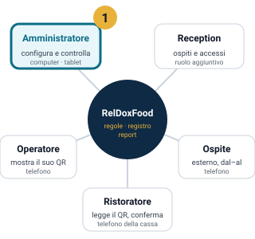
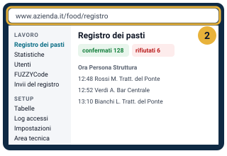
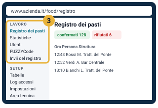
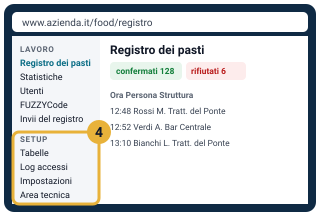
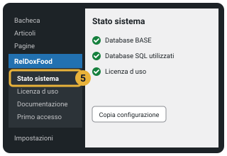

# La mappa dell applicazione

> ⛔ **Documento riservato · non divulgabile** — Idea Technologies srl soc. Uninominale. *(Finché è interno; i materiali pubblici li marca il Marketing.)* Stile: `docs/STILE-DEI-MATERIALI-v1.md` 1.1 · Iris: `docs/IRIS-v1.md`. Percorso 1 «Configurare RelDoxFood», tappa 1 di 9. Anteprima per i tre schermi: `1-1-la-mappa-dell-applicazione.html`.

 **Iris:** «Sei qui: tappa 1. Ci vogliono 6 minuti.» · «Dopo questa, sai sempre dove cercare.»

## 1 · In 30 secondi
**Saprai:** chi fa che cosa in RelDoxFood e dove trovi ogni cosa. **Ci vogliono:** 6 minuti. **Ti serve:** il computer, l indirizzo di RelDoxFood della tua azienda e la tua password di amministratore.

## 2 · Passo per passo
1. **Trova il tuo ruolo nella mappa.** → *vedi:* cinque ruoli intorno a RelDoxFood. Tu sei l **Amministratore** (chi configura e controlla): lavori dal computer o dal tablet.
    *(numero ① nella figura)*
2. **Apri RelDoxFood dal computer, all indirizzo della tua azienda.** L indirizzo finisce con **/food/**, per esempio *www.azienda.it/food/*. → *vedi:* dopo l accesso si apre il **«Registro dei pasti»**; a sinistra, la colonna del menu.
    *(numero ②)*
3. **Guarda il gruppo «LAVORO» in alto a sinistra.** → *vedi:* **«Registro dei pasti»**, **«Statistiche»**, **«Utenti»**, **«FUZZYCode»** (i codici cumulativi per un referente e i suoi ospiti), **«Invii del registro»** (i report automatici). È il lavoro di ogni giorno.
    *(numero ③)*
4. **Guarda il gruppo «SETUP» più in basso.** → *vedi:* **«Tabelle»** (i testi delle notifiche), **«Log accessi»**, **«Impostazioni»**, **«Area tecnica»**. È la configurazione: ci torni di rado.
    *(numero ④)*
5. **In WordPress, apri «RelDoxFood» › «Stato sistema».** → *vedi:* i controlli del sistema, **tutti verdi**. Nello stesso menu c è **«Licenza d uso»**. Tutto il resto si fa dentro l applicazione.
    *(numero ⑤)*

## 3 · I riquadri
> **💡 Suggerimento** — Salva l indirizzo **/food/** fra i preferiti del browser: ci entri con un clic, senza passare da WordPress.
>
> **📌 Ricorda** — Se mangi anche tu, hai **un solo account**: la tua scheda con il ruolo Admin. Dal computer vedi l amministrazione, dal telefono il tuo QR.
>
> **⚠️ Attenzione** — Le **«Statistiche»** le vede solo l amministratore. Per registrare gli ospiti e consegnare gli accessi c è il ruolo **Reception**: non serve dare il ruolo Admin a chi fa solo questo.
>
> **🔧 Se non funziona** — Un controllo di **«Stato sistema»** non è verde → non andare avanti con la tappa 2. Tocca **«Copia configurazione»** nella stessa pagina e segui la scala dell aiuto qui sotto.

*(Nel Markdown le icone sono segnaposto: RelDoxAcademy le mostra con le icone SVG della famiglia.)*

## 4 · Prova tu
Apri RelDoxFood dal computer. Senza cambiare nulla, tocca una voce del gruppo «LAVORO» e una del gruppo «SETUP», poi torna al «Registro dei pasti». → **ce l hai fatta se** sai dire, senza guardare, in quale gruppo stanno **«Invii del registro»** e **«Impostazioni»**.

## 5 · Hai capito?
1. Devi vedere quanti pasti ci sono stati ieri. Dove guardi? — a) «Registro dei pasti» b) «Impostazioni» c) «Licenza d uso» in WordPress
   - giusta: a · sì: Giusto: il registro mostra pasti e tentativi, con i filtri per data. · no: Non proprio: i pasti stanno nel «Registro dei pasti», nel gruppo «LAVORO». Riguarda il passo 3.
2. Che cosa resta nel menu di WordPress? — a) gli utenti e i ristoranti b) lo «Stato sistema» e la «Licenza d uso» c) tutto il lavoro di ogni giorno
   - giusta: b · sì: Giusto: in WordPress solo ciò che deve stare lì; il resto è nell applicazione. · no: Quasi. Riguarda il passo 5: in WordPress restano lo stato del sistema e la licenza.
3. Un collega deve solo registrare gli ospiti alla portineria. Che ruolo gli serve? — a) Admin b) Reception c) Ristoratore
   - giusta: b · sì: Giusto: Reception registra gli ospiti e consegna gli accessi, senza vedere la configurazione. · no: No: per questo c è il ruolo Reception. Riguarda la mappa del passo 1.

## 6 · In una riga
**Lavoro per ogni giorno, Setup per la configurazione, WordPress solo per lo stato e la licenza.**

## 7 · Se ancora non va
1. Rileggi il passo e guarda la figura. 2. «Se non funziona» qui sopra e le domande frequenti di RelDoxFood. 3. Chi, nella tua azienda, segue il sito WordPress. 4. Solo se ancora non va: l assistenza, con il testo di «Copia configurazione». *(recapito a cura del Marketing)*

 **Iris:** «Fatto! Prossima tappa: La prima configurazione.»

## Registro delle modifiche
| versione | data | che cosa | perché |
|---|---|---|---|
| 1 | 2026-11-17 | prima stesura | indice v2.1 approvato (owner 17/11/2026 10:17, chat Formazione F001: *«si ok»*); APERTURA F002 § 01.2 |

*⛔ Documento riservato · non divulgabile — Idea Technologies srl soc. Uninominale*
