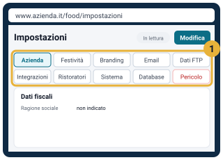
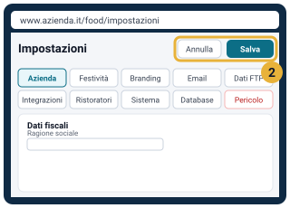
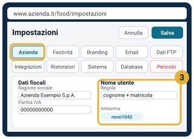
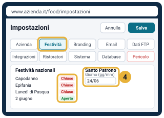
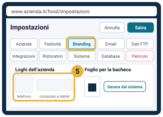
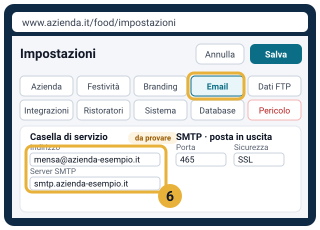
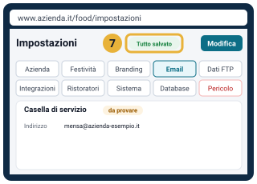
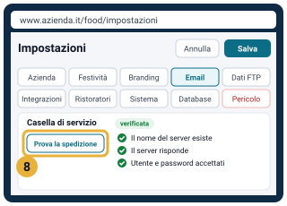

# La prima configurazione

> ⛔ **Documento riservato · non divulgabile** — Idea Technologies srl soc. Uninominale. *(Finché è interno; i materiali pubblici li marca il Marketing.)* Stile: `docs/STILE-DEI-MATERIALI-v1.md` 1.1 · Iris: `docs/IRIS-v1.md`. Percorso 1 «Configurare RelDoxFood», tappa 2 di 9. Anteprima: `1-2-la-prima-configurazione.html` (si rigenera con `strumenti/anteprima-lezione.py`).

 **Iris:** «Sei qui: tappa 2. Ci vogliono 10 minuti.» · «Dopo questa, gli inviti ai colleghi possono partire.»

## 1 · In 30 secondi
**Saprai:** preparare RelDoxFood prima di invitare la prima persona. **Ci vogliono:** 10 minuti. **Ti serve:** il computer, i dati dell azienda, i due loghi e i dati della casella di posta di servizio.

## 2 · Passo per passo
1. **Apri «Impostazioni» nel gruppo «SETUP».** → *vedi:* la pagina si apre **«In lettura»**, con un pannello di pulsanti: **«Azienda»**, **«Festività»**, **«Branding»**, **«Email»** e gli altri. Un campo vuoto si legge «non indicato».
    *(numero ①)*
2. **Tocca «Modifica» in alto a destra.** → *vedi:* al suo posto **«Annulla»** e **«Salva»**. Adesso puoi scrivere in **tutte** le sezioni insieme.
    *(numero ②)*
3. **In «Azienda», compila i dati fiscali, i recapiti e la regola del nome utente.** → *vedi:* sotto la regola, l **anteprima** del nome utente, per esempio *rossi1042* (cognome + matricola).
    *(numero ③)*
4. **In «Festività», scegli «Chiuso» o «Aperto» per ogni festa e scrivi il Santo Patrono.** → *vedi:* le festività nazionali con le date dell anno, calcolate dal prodotto; il Santo Patrono si scrive come giorno e mese (gg/mm).
    *(numero ④)*
5. **In «Branding», carica i due loghi.** → *vedi:* un posto per il logo **quadrato** (telefono) e uno per il logo **orizzontale** (computer e tablet). Accanto, il **«Foglio per la bacheca»**: lo prepari con **«Genera dal sistema»**.
    *(numero ⑤)*
6. **In «Email», compila la «Casella di servizio».** → *vedi:* indirizzo, posta in uscita e in arrivo. La casella è il mittente di **tutti** gli inviti e i report; per ora è **«da provare»**.
    *(numero ⑥)*
7. **Tocca «Salva».** → *vedi:* la pagina torna in lettura e dice **«Tutto salvato»**.
    *(numero ⑦)*
8. **Tocca «Modifica», poi in «Email» tocca «Prova la spedizione».** → *vedi:* l esito **passo per passo**: il server esiste, risponde, accetta utente e password. Tutto verde: la casella è **verificata**. La prova spedisce davvero un messaggio all indirizzo di **«Spedisci la prova a»**.
    *(numero ⑧)*

## 3 · I riquadri
> **💡 Suggerimento** — Prepara prima i due loghi: uno **quadrato** e uno **orizzontale**. Entrano nelle pagine, nelle mail e nei report.
>
> **📌 Ricorda** — Le festività valgono per **tutte** le strutture. Il Santo Patrono non è una festa nazionale: cambia da comune a comune.
>
> **⚠️ Attenzione** — Senza casella **verificata** gli inviti **non partono**. Prima di invitare chiunque, fai «Prova la spedizione». La sezione **«Pericolo»** contiene operazioni che non si annullano: si usa solo con Idea Technologies.
>
> **🔧 Se non funziona** — Un passo della prova è rosso → leggi la riga: dice che cosa correggere (per esempio il server o la password). Correggi, tocca «Salva», poi di nuovo «Modifica» e «Prova la spedizione».

*(Nel Markdown le icone sono segnaposto: RelDoxAcademy le mostra con le icone SVG della famiglia.)*

## 4 · Prova tu
Con dati inventati, in un ambiente di prova: scrivi la ragione sociale *Azienda Esempio S.p.A.*, scegli la regola «cognome + matricola», segna Capodanno «Chiuso» e il Santo Patrono *24/06*, poi tocca «Salva». → **ce l hai fatta se** la pagina dice «Tutto salvato» e, riaperta, mostra in lettura i dati che hai scritto.

## 5 · Hai capito?
1. Vuoi cambiare la ragione sociale. Che cosa tocchi per primo? — a) «Salva» b) «Modifica» c) «Pericolo»
   - giusta: b · sì: Giusto: la pagina si apre in lettura; «Modifica» apre tutte le sezioni insieme. · no: Quasi. Riguarda il passo 2: prima «Modifica», alla fine «Salva».
2. Gli inviti ai colleghi non partono. Che cosa controlli? — a) i loghi b) le festività c) che la casella di servizio sia verificata
   - giusta: c · sì: Giusto: senza casella verificata gli inviti non partono. · no: No: i loghi e le festività non fermano gli inviti. Riguarda il passo 8.
3. Il Santo Patrono vale… — a) per tutte le aziende d Italia b) per la tua azienda, perché cambia da comune a comune c) solo per un ristorante
   - giusta: b · sì: Giusto: non è una festa nazionale, lo scrivi tu in gg/mm. · no: Non proprio: cambia da comune a comune, per questo lo scrivi tu. Riguarda il passo 4.

## 6 · In una riga
**Modifica, Azienda, Festività, Branding, Email, Salva: poi prova la spedizione.**

## 7 · Se ancora non va
1. Rileggi il passo e guarda la figura. 2. «Se non funziona» qui sopra e le domande frequenti di RelDoxFood. 3. Per la casella di posta: chi, nella tua azienda, gestisce la posta elettronica. 4. Solo se ancora non va: l assistenza, con il testo di «Copia configurazione». *(recapito a cura del Marketing)*

 **Iris:** «Fatto! Prossima tappa: Caricare le anagrafiche.»

## Registro delle modifiche
| versione | data | che cosa | perché |
|---|---|---|---|
| 1 | 2026-11-17 | prima stesura; segue lo schermo della 1.24.11 (pannello di pulsanti, «Modifica»), non le linguette del manuale | indice v2.1 approvato (owner 17/11/2026 10:17, chat Formazione F001); D25 (owner 17/11/2026 12:01, chat Formazione F002) |

*⛔ Documento riservato · non divulgabile — Idea Technologies srl soc. Uninominale*
